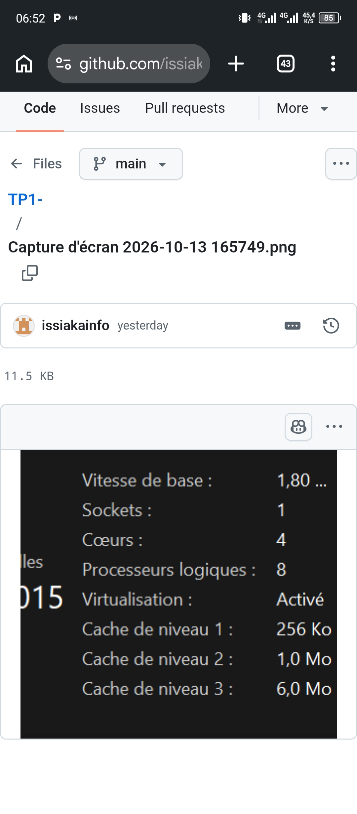
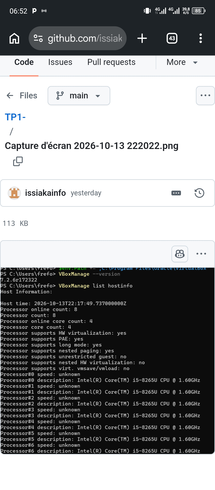
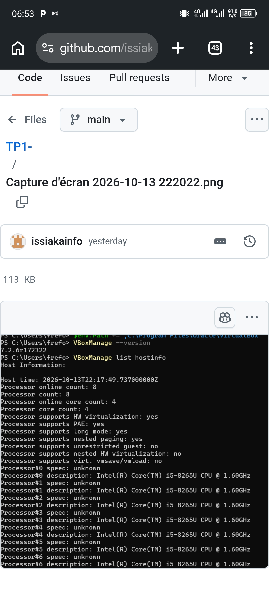

## Partie 1 — Préparer l'hôte et installer VirtualBox

### Commandes lancées

```powershell
bcdedit /enum | findstr hypervisorlaunchtype | hypervisorkaunchtype auto
systeminfo | findstr /C:"Hyper-V"|
$env:Path += ";C:\Program Files\Oracle\VirtualBox"
VBoxManage --version | 7.2.6r172322
VBoxManage list hostinfo



### Réponses

**1. Hyperviseur de type 1 et de type 2 ?**

- Un hyperviseur de **type 1** (*bare-metal*) s'exécute directement sur le matériel, sans système d'exploitation hôte intermédiaire. Il gère lui-même le CPU, la mémoire et les périphériq[...]
- Un hyperviseur de **type 2** (*hosted*) est une application qui s'exécute au-dessus d'un système d'exploitation classique (Windows, Linux, macOS), lequel garde le contrôle du matériel.
- **VirtualBox est de type 2** : il s'installe comme un logiciel sous Windows.
- Les fournisseurs cloud utilisent des hyperviseurs de type 1, par exemple **KVM** (AWS Nitro, Google Cloud), **Xen** (anciennes instances EC2) ou **Hyper-V** (Azure).

**2. Pourquoi la virtualisation matérielle (VT-x / AMD-V) est-elle indispensable pour une VM 64 bits ?**

VT-x (Intel) et AMD-V (AMD) ajoutent au processeur des modes d'exécution dédiés à la virtualisation : le code de l'invité s'exécute directement sur le CPU, avec un cloisonnement matériel vi[...]

**3. Version de VirtualBox et ressources de l'hôte**

- Version installée : `<ex. 7.2.x>`
- Cœurs détectés par `VBoxManage list hostinfo` : `<n>`
- RAM de l'hôte : `<n> Mo`

---

## Partie 2 — Télécharger et vérifier l'image ISO Ubuntu

### Commandes lancées

```powershell
cd $HOME\Downloads
Get-FileHash .\ubuntu-26.04-live-server-amd64.iso -Algorithm SHA256
Select-String -Path .\SHA256SUMS -Pattern "live-server-amd64"
```

### Sorties

```text
Empreinte calculée : <voir capture calculé>
Ligne SHA256SUMS   : <Voir capture SHA256SUMS>
Taille de l'ISO    : < 2,7 Go>
```

### Réponses

**1. Les deux empreintes sont-elles identiques ? Pourquoi vérifier ?**

- Oui, les deux empreintes sont identiques : `<à confirmer avec vos sorties>`.
- Une empreinte SHA-256 est une « signature » du contenu du fichier : le moindre bit différent produit une empreinte totalement différente.
- Vérifier l'empreinte garantit l'**intégrité** (téléchargement non corrompu) et protège contre une **image altérée** (miroir compromis, fichier piégé). On évite ainsi d'installer un sy[...]
- La vérification est complète lorsque le fichier `SHA256SUMS` lui-même est authentifié (signature GPG) ou récupéré depuis le site officiel.

**2. Ubuntu Desktop ou Ubuntu Server ?**

- **Desktop** : inclut une interface graphique (GNOME) et des applications bureautiques, destinée à un poste de travail.
- **Server** : pas d'interface graphique, administration en ligne de commande, démarrage et empreinte mémoire plus légers.
- On choisit Server pour un serveur cloud parce qu'il consomme moins de ressources (RAM, disque, CPU), expose moins de logiciels (surface d'attaque réduite), s'administre à distance par SSH et s[...]

**3. Que signifie LTS ?**

**LTS** = *Long Term Support* (support à long terme). Une version LTS reçoit **5 ans** de mises à jour de sécurité standard. Ubuntu Pro permet de prolonger ce support (jusqu'à 10 ans, voire [...]

---

## Partie 3 — Créer et configurer la machine virtuelle

### Paramètres choisis

| Paramètre | Valeur |
| --- | --- |
| Nom | ubuntu-srv |
| Type / version | Linux / Ubuntu (64-bit) |
| Installation sans surveillance | désactivée |
| Mémoire vive | 2048 Mo |
| Processeurs | 2 |
| Disque dur | VDI, 25 Go, alloué dynamiquement |
| Carte réseau 1 | NAT |
| Redirection de port | ssh, TCP, 127.0.0.1:2222 → invité :22 |



### Réponses

**1. Disque alloué dynamiquement ou de taille fixe ? Taille du .vdi après création ?**

- **Dynamique** : le fichier `.vdi` grossit au fur et à mesure que le système invité écrit des données, jusqu'à la taille maximale (25 Go). Il économise l'espace disque de l'hôte, mais l'a[...]
- **Fixe** : les 25 Go sont réservés d'emblée sur l'hôte. L'accès est un peu plus rapide et l'espace occupé est prévisible, mais on consomme tout l'espace dès le départ.
- Juste après sa création, un disque dynamique est très petit : `<taille observée du .vdi, de l'ordre de quelques Mo>`.

**2. Pourquoi désactiver l'installation sans surveillance ?**

L'installation sans surveillance applique automatiquement des choix par défaut (utilisateur, mot de passe, paramètres) et masque les étapes de l'installateur. Pour ce TP, on veut maîtriser ch[...]

**3. NAT : pourquoi l'hôte ne peut-il pas joindre directement la VM ? À quoi sert la redirection 2222 → 22 ?**

- En mode NAT, la VM est placée dans un réseau privé virtuel (typiquement 10.0.2.0/24) derrière un routeur virtuel de VirtualBox. Ce routeur traduit les adresses des connexions **sortantes** [...]
- La **redirection de port** crée une règle explicite : tout ce qui arrive sur `127.0.0.1:2222` de l'hôte est transféré au port 22 (SSH) de la VM. Elle ouvre une porte unique et contrôlée.
- C'est le même principe qu'une instance cloud dans un sous-réseau privé accessible uniquement par un point d'entrée précis (bastion, redirection, load balancer).

---

## Partie 4 — Installer Ubuntu Server

### Choix dans l'installateur

| Écran | Choix | Justification |
| --- | --- | --- |
| Langue | Français | Interface de l'installateur |
| Mise à jour de l'installateur | Continuer sans mettre à jour | Gain de temps, mises à jour faites ensuite avec `apt` |
| Clavier | French (AZERTY) | Correspond au clavier physique |
| Type d'installation | Ubuntu Server (non minimisée) | Version complète du serveur |
| Réseau | enp0s3, DHCPv4 | Adresse obtenue : `<ex. 10.0.2.15>` |
| Proxy / miroir | Par défaut | Pas de proxy dans notre contexte |
| Stockage | Disque entier avec LVM | Choix par défaut, flexible pour redimensionner |
| Profil | serveur `ubuntu-srv`, utilisateur `etudiant` | Conforme à l'énoncé |
| Ubuntu Pro | Passer | Non nécessaire pour le TP |
| SSH | Installer le serveur OpenSSH | Accès distant, voir question 3 |
| Snaps | Aucun | Installation minimale |



### Réponses

**1. Durée de l'installation ? Comparaison avec une instance cloud.**

- Durée mesurée : 47 minutes 
- Une instance cloud (EC2, Azure VM) se crée à partir d'une **image déjà installée** (AMI, image Marketplace) : l'installation du système n'a pas lieu, la machine démarre en quelques dizai[...]

**2. Adresse IP obtenue sur enp0s3, et qui l'a attribuée ?**

- Adresse obtenue : 10.0.2.15/24.
- Elle est attribuée en DHCP par le **serveur DHCP intégré à VirtualBox** (le moteur NAT), qui joue le rôle de routeur virtuel du réseau 10.0.2.0/24.

**3. Pourquoi installer OpenSSH dès l'installation ? Que se passerait-il sans SSH sur un serveur cloud ?**

- Un serveur s'administre à distance, sans écran ni clavier. OpenSSH fournit un accès en ligne de commande chiffré et authentifié, et permet aussi de copier des fichiers (`scp`) et d'automatise[...]
- Sur un serveur cloud, il n'y a pas de console physique : sans SSH (ou un autre mécanisme d'accès à distance, comme la console série ou un agent de gestion), on ne pourrait plus administrer la ma[...]

---

## Partie 5 — Premiers pas, réseau et accès SSH

### Commandes lancées dans la VM

```bash
lsb_release -a
uname -r
hostnamectl
nproc
free -h
df -h /
lsblk
ip -4 addr show
ip route
resolvectl status | grep "DNS Servers"
ping -c 3 ubuntu.com
sudo apt update && sudo apt upgrade -y
systemctl status ssh --no-pager
sudo ss -tlnp | grep :22
```

### Sorties


### Commandes lancées depuis l'hôte (PowerShell)

```powershell
ssh -p 2222 etudiant@127.0.0.1
"Bonjour depuis l'hôte" | Out-File -Encoding utf8 bonjour.txt
scp -P 2222 .\bonjour.txt etudiant@127.0.0.1:~
ssh -p 2222 etudiant@127.0.0.1 "cat ~/bonjour.txt"
```

```text
<coller ici la sortie de la dernière commande>
```

### Réponses

**1. Adresse IP, masque, passerelle, DNS de la VM. À quoi correspond 10.0.2.2 ?**

| Élément | Valeur |
| --- | --- |
| Adresse IP | `<ex. 10.0.2.15>` |
| Masque | `<ex. /24 soit 255.255.255.0>` |
| Passerelle | `<ex. 10.0.2.2>` |
| Serveur DNS | `<ex. 10.0.2.3>` |

L'adresse **10.0.2.2** est la passerelle par défaut : c'est le **routeur virtuel de VirtualBox** (le moteur NAT). Il fait passer le trafic de la VM vers l'extérieur en traduisant ses adresses, et c'[...]

**2. Pourquoi se connecter à 127.0.0.1:2222 et non à 10.0.2.15:22 ?**

10.0.2.15 est une adresse privée qui n'existe qu'à l'intérieur du réseau NAT de VirtualBox : l'hôte n'a pas de route vers elle. La seule façon d'atteindre le service SSH de la VM est la red[...]

**3. Message de première connexion SSH (empreinte) : contenu et risque évité**

- Le message affiche l'**empreinte de la clé d'hôte** du serveur (par exemple `SHA256:...`, algorithme ED25519 ou ECDSA) et demande si on lui fait confiance. En acceptant (`yes`), le client enregis[...]
- Cela permet de vérifier l'identité du serveur et d'éviter une attaque de type **homme du milieu** : si un attaquant se fait passer pour le serveur, l'empreinte sera différente et SSH affichera u[...]

**4. Avantages de l'authentification par clé**

- Aucun mot de passe ne circule sur le réseau : le serveur vérifie que le client possède la clé privée, qui n'est jamais transmise.
- Une clé ed25519 est impossible à deviner par force brute, contrairement à un mot de passe faible, et peut en plus être protégée par une phrase secrète.
- Elle permet des connexions automatisées (scripts, déploiements) sans saisir de mot de passe, et on peut ensuite **désactiver** l'authentification par mot de passe.
- Les fournisseurs cloud l'imposent par défaut parce que les instances sont exposées sur Internet et que le port 22 est attaqué en permanence par des tentatives de mots de passe automatisées.[...]

---

## Partie 6 — Instantané, clone et arrêt

### Commandes lancées

```powershell
VBoxManage snapshot ubuntu-srv take apres-installation --description "Ubuntu installé, OpenSSH actif"
VBoxManage snapshot ubuntu-srv list

# dans la VM (SSH)
sudo apt install -y htop
touch ~/avant-restauration.txt
sudo poweroff

# restauration
VBoxManage snapshot ubuntu-srv restore apres-installation
VBoxManage startvm ubuntu-srv --type headless
ssh -p 2222 etudiant@127.0.0.1 "which htop; ls ~"

# clone
VBoxManage controlvm ubuntu-srv acpipowerbutton
VBoxManage clonevm ubuntu-srv --name ubuntu-clone --register
VBoxManage modifyvm ubuntu-clone --natpf1 delete ssh
VBoxManage modifyvm ubuntu-clone --natpf1 "ssh,tcp,127.0.0.1,2223,,22"
VBoxManage startvm ubuntu-clone --type headless
ssh -p 2223 etudiant@127.0.0.1 "sudo hostnamectl set-hostname ubuntu-clone; hostname"
VBoxManage list runningvms

# comparaison de l'espace puis suppression du clone
Get-ChildItem "$HOME\VirtualBox VMs" -Directory | ForEach-Object { "{0} : {1:N2} Go" -f $_.Name, ((Get-ChildItem $_.FullName -Recurse -File | Measure-Object Length -Sum).Sum / 1GB) }
VBoxManage controlvm ubuntu-clone acpipowerbutton
VBoxManage unregistervm ubuntu-clone --delete
```

### Sorties

```text
Après restauration (which htop; ls ~) : <sortie : htop et avant-restauration.txt ont disparu>
Espace occupé : ubuntu-srv = <x,xx Go> ; ubuntu-clone = <x,xx Go>
```

### Réponses

**1. Instantané ou clone ? Un instantané est-il une sauvegarde ?**

- Un **instantané** (*snapshot*) fige l'état d'une VM à un instant donné, ce qui permet d'y revenir. VirtualBox enregistre ensuite les modifications dans un disque différentiel qui dépend d[...]
- Un **clone** est une **copie indépendante** de la VM (disque, configuration), qui devient une machine à part entière avec sa propre vie.
- Un instantané **n'est pas une vraie sauvegarde** : il reste sur le même disque et dépend du disque de base. Si le fichier `.vdi` ou le disque de l'hôte est perdu ou corrompu, l'instantané [...]

**2. Équivalents cloud de l'instantané et du clone**

- **Instantané** : le *snapshot de disque* (EBS snapshot sur AWS, snapshot de disque managé sur Azure). Dans le cloud, ces snapshots sont stockés séparément sur un stockage durable, ce qui l[...]
- **Clone** : une **image** de la machine (AMI sur AWS, image personnalisée sur Azure), à partir de laquelle on lance autant d'instances identiques que nécessaire.

**3. Différence entre `acpipowerbutton` et `poweroff` dans `VBoxManage controlvm`**

- `acpipowerbutton` simule l'appui sur le bouton d'alimentation : l'invité reçoit un événement ACPI et s'**arrête proprement** (services stoppés, disques synchronisés).
- `poweroff` coupe la VM **immédiatement**, comme si on débranchait la prise : cela risque de corrompre le système de fichiers ou de perdre des données non écrites. À réserver aux VM bloqu[...]

**4. Pourquoi démarrer une VM en mode headless ?**

Le mode *headless* démarre la VM sans fenêtre graphique : on économise des ressources et on administre la machine uniquement par SSH. C'est exactement le fonctionnement d'une instance cloud, q[...]

**5. Pourquoi changer le port hôte et le nom d'hôte du clone ?**

- **Port hôte** : le clone hérite de la règle `2222 → 22`. Deux VM ne peuvent pas écouter sur le même port de l'hôte à la fois : la seconde échouerait ou entrerait en conflit. On utilis[...]
- **Nom d'hôte** : le clone est une copie exacte, donc il porte le même nom que l'original. Deux machines de même nom créent de la confusion (journaux, supervision, DNS, prompts SSH identique[...]

---

## Conclusion

Ce TP m'a permis de reproduire à petite échelle ce qu'automatise un fournisseur IaaS : un hyperviseur (VirtualBox), une machine virtuelle créée et configurée, un réseau privé accessible pa[...]
